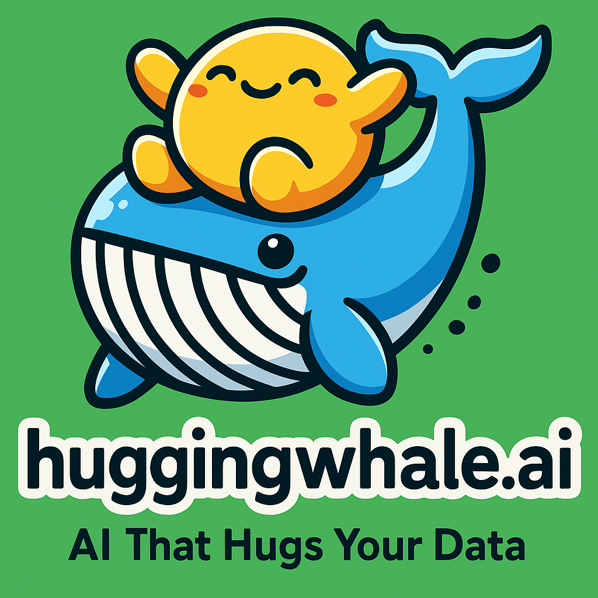

  

<h1 align="center">🤗🐋 HuggingWhale.AI</h1>

<em>AI That Hugs Your Data</em>

  

</a>  
HuggingWhale.AI implements a modern Retrieval-Augmented Generation (RAG) pipeline purpose-built for unstructured document understanding and conversational querying. The system combines semantic chunking, vector embeddings, hybrid retrieval, and large language model (LLM) synthesis to deliver accurate and context-aware responses.

## 🧠 How It Works

HuggingWhale.AI is a RAG (Retrieval-Augmented Generation) system built for real-time, doc-aware LLM interactions.

Here's how the data flows through the whale 🐋:

