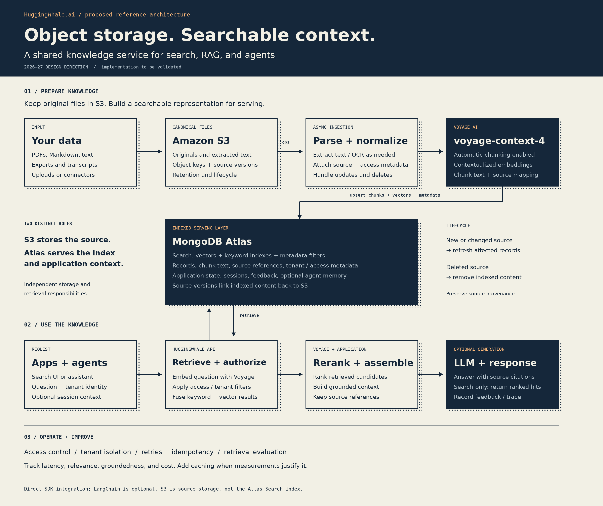

<h1 align="center">HuggingWhale.AI</h1>

  <code>V2 / OBJECT STORAGE + SEARCHABLE CONTEXT</code>

  <strong>Hug your data.</strong> 
  A shared knowledge service for search, RAG, and agents.

  <a href="./QUICKSTART.md">Get Started</a> ·
  <a href="./tech_stack.md">Tech Stack</a> ·
  <a href="https://www.buymeacoffee.com/jgschmitz">Support the Project</a>

---

HuggingWhale.AI turns documents in Amazon S3 into searchable, source-linked
context for applications and AI agents.

Voyage AI handles automatic chunking and contextualized embeddings.
MongoDB Atlas stores the indexed content and combines vector and keyword
search. Voyage reranking brings the most relevant results forward, while
optional LLM generation produces answers with numbered source references.

Use it as a search service, a document assistant, or a retrieval API for
your own agents.

## How It Works

**Prepare knowledge**  
Upload documents → store originals in S3 → extract text → automatically
chunk and embed with Voyage → index in Atlas.

**Retrieve and answer**  
Submit a question → apply tenant and access filters → combine vector and
keyword results → rerank → return relevant passages or generate an answer
with sources.

**Operate and improve**  
Process ingestion through durable jobs, track source revisions, handle
updates and removals, and collect latency, token usage, and feedback.

S3 holds the canonical files. Atlas serves the searchable content.
Direct provider integrations keep the pipeline free of LangChain and
local embedding-model dependencies.

## Architecture

